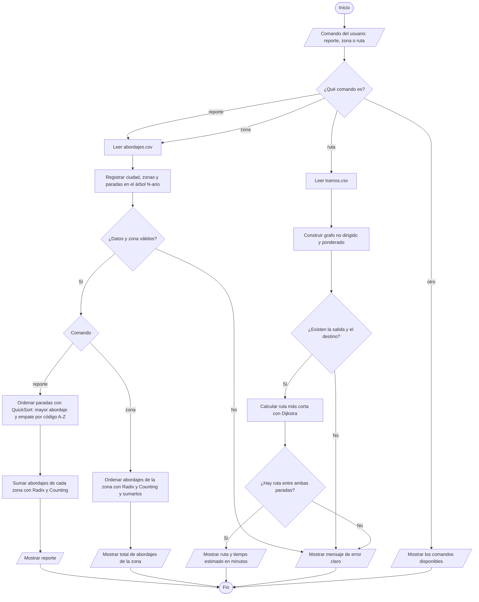
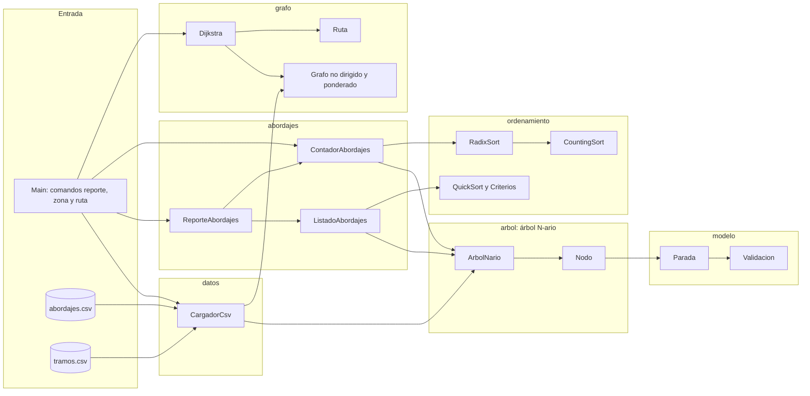
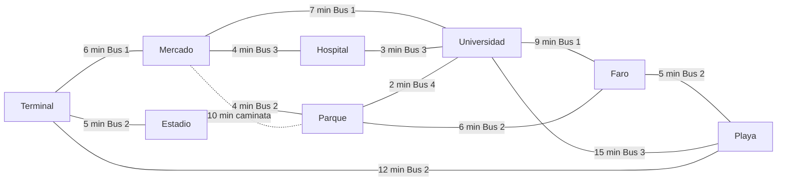

# Examen-Proyecto: Sistema de Rutas y Abordajes de Transporte Público

## 1. Nombre del examen-proyecto

**Sistema de Rutas y Abordajes de Transporte Público**: registro de ciudades, zonas y paradas en un árbol N-ario; conteo y listado de abordajes diarios con Radix/Counting y QuickSort; y cálculo de la ruta más corta con Dijkstra sobre un grafo no dirigido y ponderado.

## 2. Autores

- Mariel Herrera
- Luis Rodriguez

## 3. Requerimientos del sistema

**Lista de requerimientos**

**→ Funcionales**

1. El sistema debe ser capaz de registrar Ciudades, zonas y paradas mediante un árbol N-ario. (F1)
2. Debe poder contabilizar la cantidad de abordajes diarios de cualquier zona de toda la ciudad usando Radix con Counting como métodos de ordenamiento. (F1)
3. Se debe generar un listado de 1,200 paradas de acuerdo a mayor a menor abordaje, usando quicksort. (F2)
4. En caso de un empate en el listado de abordaje el ordenamiento debe ser por código de parada de la A-Z, usando quicksort. (F2)
5. Debe permitir generar un reporte, con los datos anteriores, por lo que se necesita que el tiempo de ejecución sea garantizado incluso en el peor de los casos. (F2)
6. El sistema debe permitir al cliente/pasajero seleccionar un punto de salida y un destino. (F3)
   - Debe devolverle la ruta más corta y el tiempo estimado en llegar. (F3)
   - Para ello deberá emplear un grafo no dirigido, ponderado de tipo Dijkstra. (F3)

**→ No funcionales**

1. Validar que el reporte muestre el listado de abordajes organizado de manera descendente o bien, de la A-Z, por su código de parada. (F2)
2. Debe permitir que la información proporcionada al usuario utilice un lenguaje claro o sencillo y que satisfaga la necesidad del cliente.

## 4. Instrucciones de instalación y ejecución

### Requisitos

- JDK 17 o superior
- Maven 3.8 o superior (descarga JUnit 5 la primera vez)

### Instalación

1. Descargue o clone el proyecto y ubíquese en su carpeta raíz (la que contiene `pom.xml` y la carpeta `datos`).
2. Compile:

   ```bash
   mvn compile
   ```

Si usa el repositorio base del curso, copie en él las carpetas `src/main/java/transporte`, `src/test/java/transporte` y `datos`; se conserva la configuración de JUnit que el repositorio ya trae. El `pom.xml` incluido solo declara JUnit 5 (Jupiter) y el plugin Surefire.

### Ejecución

Todos los comandos se ejecutan desde la carpeta raíz, porque el programa lee `datos/abordajes.csv` y `datos/tramos.csv`.

| Comando | Qué hace |
|---|---|
| `java -cp target/classes transporte.Main` | Muestra los comandos disponibles |
| `java -cp target/classes transporte.Main reporte` | Reporte de abordajes, de mayor a menor abordaje (empates por código de A a Z) |
| `java -cp target/classes transporte.Main zona Norte` | Abordajes diarios de la zona indicada |
| `java -cp target/classes transporte.Main ruta Terminal Faro` | Ruta más corta y tiempo estimado entre dos paradas |

Ejemplo de salida:

```text
$ java -cp target/classes transporte.Main ruta Terminal Faro
Ruta más corta: Terminal -> Estadio -> Parque -> Faro. Tiempo estimado: 15 minutos.
```

Nota: el archivo `abordajes.csv` no trae columna de ciudad, por lo que el programa registra todas sus zonas y paradas bajo una ciudad llamada `Ciudad` (constante `Main.CIUDAD`). Si la consola muestra mal las tildes en Windows, ejecute `chcp 65001` antes.

### Cómo ejecutar las pruebas

```bash
mvn test                        # compila y ejecuta todas las pruebas
mvn -Dtest=DijkstraTest test    # ejecuta una sola clase de pruebas
```

En IntelliJ IDEA: clic derecho sobre la carpeta `src/test/java` y *Run 'All Tests'*.

Cada requerimiento funcional tiene pruebas de los tres tipos pedidos:

- **Valor exacto esperado**: por ejemplo, `Terminal → Faro` debe dar exactamente 15 minutos y el recorrido `Terminal, Estadio, Parque, Faro`; la zona `Centro` debe sumar exactamente 3810 abordajes.
- **Casos límite**: zona o ciudad vacía, origen igual al destino, empates entre abordajes y entre rutas, una sola parada, arreglos vacíos, 1,200 paradas, tramos paralelos, paradas sin conexión.
- **Entradas inválidas**: parada, zona o ciudad inexistente, datos nulos o en blanco, códigos repetidos, abordajes negativos, tiempos en cero, y CSV mal formados; en todos los casos se verifica el mensaje de error exacto.

| Requerimiento | Clases de prueba (`src/test/java/transporte/`) |
|---|---|
| RF1, req. 1 (árbol N-ario) | `arbol/ArbolNarioTest` |
| RF1, req. 2 (Radix con Counting) | `ordenamiento/RadixSortTest`, `ordenamiento/CountingSortTest`, `abordajes/ContadorAbordajesTest` |
| RF2, req. 3 y 4 (listado con QuickSort y desempate) | `ordenamiento/QuickSortTest`, `abordajes/ListadoAbordajesTest` |
| RF2, req. 5 (reporte y peor caso garantizado) | `abordajes/ReporteAbordajesTest`, `ordenamiento/QuickSortTest` (pruebas de peor caso) |
| RF3, req. 6 (ruta más corta con Dijkstra) | `grafo/DijkstraTest`, `grafo/GrafoTest` |
| RNF1 (orden del reporte) | `RequisitosNoFuncionalesTest` |
| RNF2 (lenguaje claro) | `RequisitosNoFuncionalesTest`, `MainTest` |
| Datos de entrada (CSV) | `datos/CargadorCsvTest` |

**Sobre el requerimiento 5 (tiempo garantizado en el peor caso).** Un QuickSort corriente baja a O(n²) con entradas ya ordenadas o con todos los valores iguales. Aquí el pivote de cada partición es la mediana real del tramo (mediana de medianas) y la partición separa menores, iguales y mayores, de modo que el costo es O(n log n) siempre. Las pruebas lo miden contando comparaciones: con 1,200 paradas y entradas difíciles (ascendente, descendente, todas iguales, "órgano", sierra) el máximo medido fue 73,885 comparaciones, contra unas 720,000 de un QuickSort con pivote fijo, y al duplicar las paradas el costo crece 2.3 veces (un algoritmo cuadrático lo cuadruplicaría).

## 5. Jerarquía de carpetas del proyecto

```text
rutas-y-abordajes/
├── pom.xml
├── README.md
├── PROMPTS.md
├── datos/
│   ├── abordajes.csv
│   └── tramos.csv
└── src/
    ├── main/java/transporte/
    │   ├── Main.java
    │   ├── modelo/
    │   │   ├── Parada.java
    │   │   └── Validacion.java
    │   ├── arbol/
    │   │   ├── Nodo.java
    │   │   └── ArbolNario.java
    │   ├── ordenamiento/
    │   │   ├── Criterio.java
    │   │   ├── Criterios.java
    │   │   ├── QuickSort.java
    │   │   ├── CountingSort.java
    │   │   └── RadixSort.java
    │   ├── abordajes/
    │   │   ├── ContadorAbordajes.java
    │   │   ├── ListadoAbordajes.java
    │   │   └── ReporteAbordajes.java
    │   ├── grafo/
    │   │   ├── Grafo.java
    │   │   ├── Dijkstra.java
    │   │   ├── Ruta.java
    │   │   └── RutaNoEncontradaException.java
    │   └── datos/
    │       └── CargadorCsv.java
    └── test/java/transporte/
        ├── DatosDePrueba.java
        ├── MainTest.java
        ├── RequisitosNoFuncionalesTest.java
        ├── arbol/ArbolNarioTest.java
        ├── ordenamiento/ (RadixSortTest, CountingSortTest, QuickSortTest)
        ├── abordajes/ (ContadorAbordajesTest, ListadoAbordajesTest, ReporteAbordajesTest)
        ├── grafo/ (DijkstraTest, GrafoTest)
        └── datos/CargadorCsvTest.java
```

### Qué hace cada módulo y clase

| Módulo | Clase | Qué hace |
|---|---|---|
| (raíz) | `Main` | Punto de entrada por línea de comandos: `reporte`, `zona` y `ruta`. Imprime mensajes sencillos para el usuario. |
| `modelo` | `Parada` | Una parada: código, nombre, zona y abordajes diarios. Rechaza datos vacíos y abordajes negativos. |
| `modelo` | `Validacion` | Validación de texto obligatorio con el mensaje "Debe indicar ...". |
| `arbol` | `Nodo` | Nodo del árbol N-ario (raíz, ciudad, zona o parada). Guarda sus hijos en un arreglo que crece. |
| `arbol` | `ArbolNario` | Registra ciudades, zonas y paradas (raíz → ciudad → zona → parada) y las consulta. El código de parada es único. |
| `ordenamiento` | `Criterio` | Interfaz para comparar dos paradas. |
| `ordenamiento` | `Criterios` | El criterio del sistema: mayor abordaje y, en caso de empate, código de parada de A a Z. |
| `ordenamiento` | `QuickSort` | QuickSort de paradas con pivote por mediana de medianas (peor caso O(n log n)). |
| `ordenamiento` | `CountingSort` | Counting sort estable por un dígito decimal. |
| `ordenamiento` | `RadixSort` | Radix sort LSD (base 10) que usa `CountingSort` en cada dígito. |
| `abordajes` | `ContadorAbordajes` | Abordajes diarios de una zona: ordena con Radix + Counting y suma. Una zona vacía da 0. |
| `abordajes` | `ListadoAbordajes` | Genera el arreglo de paradas de una ciudad ordenado con QuickSort (mayor abordaje; empates por código A-Z). |
| `abordajes` | `ReporteAbordajes` | Genera el texto del reporte: total por zona y listado ordenado de paradas. |
| `grafo` | `Grafo` | Grafo no dirigido y ponderado (paradas y tramos en minutos) con arreglos. |
| `grafo` | `Dijkstra` | Ruta más corta entre dos paradas del grafo. |
| `grafo` | `Ruta` | Resultado: paradas del recorrido, minutos totales y descripción en lenguaje sencillo. |
| `grafo` | `RutaNoEncontradaException` | Error cuando las dos paradas existen pero no están conectadas. |
| `datos` | `CargadorCsv` | Lee `abordajes.csv` (árbol N-ario) y `tramos.csv` (grafo) y valida cada línea. |

### Restricciones técnicas respetadas

- Solo se usan arreglos (`int[]`, `String[]`, `Parada[]`, `Nodo[]`) y `String`; no hay ninguna colección de `java.util`.
- No se usa `Arrays.sort`, `Collections.sort`, `List.sort` ni `sorted()` de Streams: todos los ordenamientos son propios (`QuickSort`, `RadixSort`, `CountingSort`).
- No se usan bibliotecas de caminos más cortos ni de grafos: `Grafo` y `Dijkstra` están implementados en el proyecto.
- Las pruebas usan únicamente JUnit.

## 6. Requerimientos desarrollados por los estudiantes

**Requerimientos excluidos: ninguno.** Se implementaron todos los requerimientos de la lista.

| Requerimiento | Estado | Cómo se cumple |
|---|---|---|
| RF1, req. 1: registrar ciudades, zonas y paradas en un árbol N-ario | Implementado | `ArbolNario` y `Nodo`; `CargadorCsv` lo llena con `abordajes.csv`. |
| RF1, req. 2: abordajes diarios de cualquier zona con Radix y Counting | Implementado | `ContadorAbordajes` ordena con `RadixSort`, que usa `CountingSort` en cada dígito. |
| RF2, req. 3: listado de 1,200 paradas de mayor a menor abordaje con QuickSort | Implementado | `ListadoAbordajes` con `QuickSort`; se prueba con 1,200 paradas. |
| RF2, req. 4: empates por código de parada de A a Z con QuickSort | Implementado | `Criterios.MAYOR_ABORDAJE_Y_CODIGO`, usado por el mismo `QuickSort`. |
| RF2, req. 5: reporte con tiempo garantizado en el peor caso | Implementado | `ReporteAbordajes`; `QuickSort` con pivote por mediana de medianas (O(n log n) siempre). |
| RF3, req. 6: seleccionar salida y destino; ruta más corta y tiempo estimado con un grafo no dirigido y ponderado de tipo Dijkstra | Implementado | `Grafo`, `Dijkstra` y `Ruta`; `CargadorCsv` arma el grafo con `tramos.csv`. |
| RNF1: el reporte muestra el listado de abordajes organizado de manera descendente o bien, de la A-Z, por su código de parada | Implementado | `ReporteAbordajes` muestra el listado de mayor a menor abordaje y, cuando hay empate, por código de parada de A a Z (`Criterios.MAYOR_ABORDAJE_Y_CODIGO`). |
| RNF2: información al usuario en lenguaje claro o sencillo | Implementado | Mensajes y reportes en español sencillo (`Ruta.descripcion()`, `ReporteAbordajes`, mensajes de error). Las pruebas verifican el texto exacto y que no aparezcan términos técnicos. Que la información "satisfaga la necesidad del cliente" no se puede comprobar con una prueba automática. |

## 7. Diagramas

### 7.1 Diagrama de flujo



### 7.2 Diagrama de componentes



### 7.3 Diagrama del grafo que emplea el sistema

Grafo no dirigido y ponderado construido con `tramos.csv`. El peso de cada arista son los minutos del tramo y cada tramo se puede recorrer en ambos sentidos. La línea punteada es la caminata (ambos sentidos).


